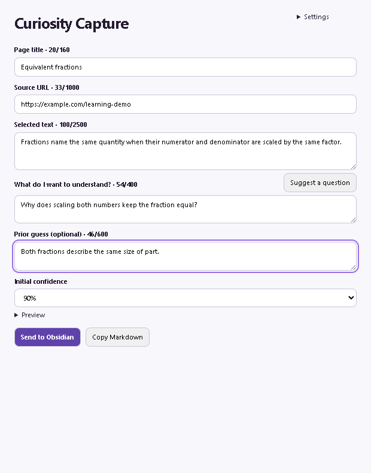

# Curiosity Capture

Ekstensi Chrome MV3 untuk mengubah kutipan web menjadi catatan Curiosity Learning. Bahasa bawaan English. Pilih Bahasa Indonesia di **Settings → Language**.

## Pasang lokal

1. Jalankan `npm ci` dan `npm run build`.
2. Buka `chrome://extensions`, nyalakan **Developer mode**, dan pilih **Load unpacked** pada `dist/`.
3. Pasang Curiosity Learning 0.3.0 di vault Obsidian tujuan. Gunakan vault uji untuk mencoba.

Blok teks dan pilih **Tangkap untuk Curiosity Learning** di menu klik kanan, klik ikon ekstensi, atau tekan **Alt+Shift+Y**. Periksa judul, URL, kutipan, pertanyaan, dan dugaan awal opsional. Form menandai kolom yang terpotong. **Kirim ke Obsidian** membuka tautan aplikasi. Konfirmasikan di Obsidian agar catatan dibuat di inbox.

**Salin Markdown** menghasilkan catatan lengkap `type: learning` dengan metadata skema di badan catatan. Jalankan **Impor Markdown tangkapan** di Obsidian untuk meninjaunya. Gunakan jalur ini untuk tautan di atas 8.000 karakter setelah encoding atau saat tautan aplikasi gagal. Ekstensi tidak bisa memeriksa apakah Obsidian telah menyimpan tangkapan.

## Penanganan data

Ekstensi menyimpan bahasa secara lokal dan kutipan sementara dalam sesi browser. Izin yang dipakai adalah `contextMenus`, `storage`, `activeTab`, dan `scripting`. Ekstensi membaca tab aktif setelah tindakan pengguna dan tidak membuat permintaan jaringan sendiri. [Dokumentasi activeTab Chrome](https://developer.chrome.com/docs/extensions/develop/concepts/activeTab)

Jalankan `npm test` dan `npm run package` untuk membuat `curiosity-capture-0.1.0.zip`. Memerlukan Node 22.15 atau lebih baru. Berkas `src/shared/` mengikuti kontrak tangkapan Curiosity Learning v0.3.0 dan perlu diselaraskan saat kontrak berubah.

[English](README.md) · MIT © 2026 Finarfin12
