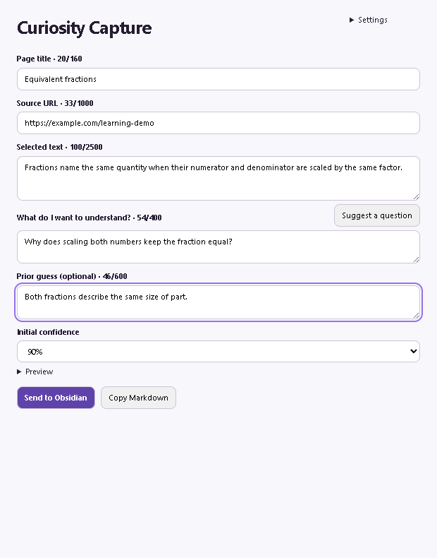

# Curiosity Capture

Chrome MV3 extension for turning selected web text into a Curiosity Learning note. English is the default. Choose Indonesian in **Settings → Language**.

## Install locally

1. Run `npm ci` and `npm run build`.
2. Open `chrome://extensions`, enable **Developer mode**, and use **Load unpacked** on `dist/`.
3. Install Curiosity Learning 0.3.0 in the Obsidian vault where you want to save captures. Start with a test vault if you are evaluating the extension.

Select text and choose **Capture for Curiosity Learning** from the context menu, click the pinned icon, or use **Alt+Shift+Y**. Check the title, URL, selection, question, and optional prior guess. The form shows when an incoming field was shortened. **Send to Obsidian** opens an app link. Confirm in Obsidian to write to the inbox.

**Copy Markdown** creates a complete learning note with `type: learning` and schema metadata in the body. Use **Import capture Markdown** in Obsidian to preview it. Use this path for captures over the encoded link limit of 8,000 characters or if the app link fails. The extension cannot confirm whether Obsidian saved your capture.

## Data handling

The extension uses local language settings and temporary browser-session data for the selected excerpt. The four permissions are `contextMenus`, `storage`, `activeTab`, and `scripting`. The extension requests data from the active tab only after a user action and sends no network requests of its own. [Chrome activeTab documentation](https://developer.chrome.com/docs/extensions/develop/concepts/activeTab)

Run `npm test` and `npm run package` to verify and build `curiosity-capture-0.1.0.zip`. Node 22.15 or later is required. The TypeScript files in `src/shared/` are the pinned Curiosity Learning v0.3.0 capture contract and should stay in sync when that contract changes.

[Bahasa Indonesia](README.id.md) · MIT © 2026 Finarfin12
